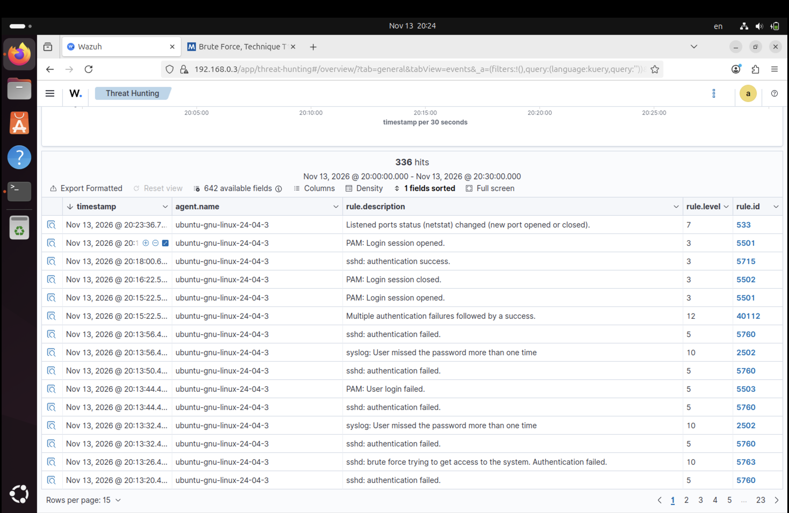

# Wazuh SIEM lab: обнаружение подбора пароля по SSH

Домашний стенд, в котором я запустил SIEM Wazuh, сымитировал атаку подбора пароля (brute force) по SSH и нашёл её в алертах.

## Схема стенда

| Машина | Роль | Адрес |
|---|---|---|
| Kali Linux (Parallels, ARM64) | атакующий | 192.168.0.36 |
| Ubuntu Server 24.04 (Parallels, ARM64) | жертва + сервер Wazuh 4.14.10 | 192.168.0.3 |

Wazuh (менеджер, индексатор, панель) установлен на Ubuntu одним установщиком (all-in-one). Менеджер читает системные логи этой же машины, включая журнал SSH.

```
Kali --SSH, неверные пароли--> Ubuntu (sshd -> логи -> Wazuh -> алерты)
```

## Что я сделал

1. Поднял две виртуальные машины в Parallels на Mac с чипом Apple Silicon.
2. Установил Wazuh на Ubuntu (all-in-one).
3. С Kali много раз подряд ввёл неверный пароль для SSH-пользователя, затем один раз вошёл успешно.
4. Нашёл события этой атаки в Wazuh (Threat Hunting -> Events).

## Результат



События атаки в хронологическом порядке (время московское):

| Правило | Что значит | Уровень |
|---|---|---|
| 5760 `sshd: authentication failed` | отдельные неудачные входы | 5 |
| 5763 `sshd: brute force trying to get access to the system` | серия неудач с одного адреса = подбор пароля | 10 |
| 2502 `syslog: User missed the password more than one time` | повторные ошибки пароля | 10 |
| 40112 `Multiple authentication failures followed by a success` | успешный вход после серии неудач | 12 |

Ключевые поля события 5763:

| Поле | Значение |
|---|---|
| `data.srcip` | 192.168.0.36 (Kali) |
| `data.dstuser` | parallels |
| `rule.level` | 10 |
| `rule.frequency` | 8 |
| `rule.mitre.id` | T1110 |
| `rule.mitre.technique` | Brute Force |
| `rule.mitre.tactic` | Credential Access |

## Что я понял

Brute Force (T1110) — это когда атакующий не знает пароль и перебирает варианты, пока один не подойдёт. Одна неудачная попытка ничего не значит, но серия неудач с одного адреса за короткое время — признак атаки. Самое опасное событие здесь не серия неудач, а успешный вход сразу после неё: это значит, что пароль мог быть угадан.

## Трудности при установке

Установщик Wazuh упал из-за того, что фоновый процесс Ubuntu держал блокировку менеджера пакетов (APT). Я разобрал лог, удалил частично установленные пакеты и остановил оставшиеся процессы Wazuh, державшие порты 1515 и 55000, после чего установка прошла.

## Что можно улучшить дальше

- Вынести Wazuh на отдельную машину и подключить Ubuntu как настоящего агента.
- Настроить автоматическую блокировку адреса атакующего (Wazuh Active Response).
- Написать собственное правило обнаружения.
